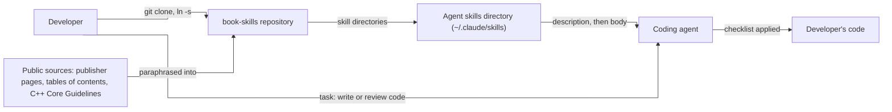
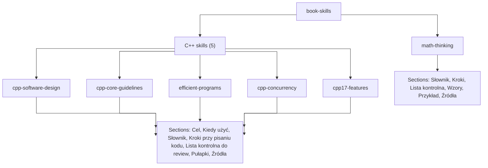
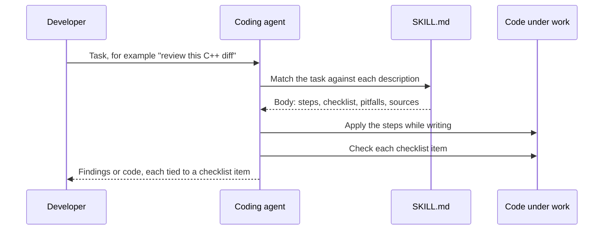

# book-skills: architecture

This document describes the structure of the repository in the arc42 layout. The repository holds six Agent Skills in the `SKILL.md` format and no executable code.

## 1 Introduction and goals

The repository turns books into checklists that an agent applies while it writes or reviews code.

| Skill | Purpose |
|---|---|
| `cpp-software-design` | Design C++ code for change: dependencies, abstractions, design patterns. |
| `cpp-core-guidelines` | Apply 30 selected C++ Core Guidelines while writing and reviewing C++. |
| `efficient-programs` | Speed up a program measurement-first, for C++, Python and numpy. |
| `cpp-concurrency` | Write and review multithreaded C++. |
| `cpp17-features` | Use C++17 language and library features correctly. |
| `math-thinking` | Solve a problem with a model, invariants, edge cases and a numeric check. |

Quality goals:

1. Each checklist item can be checked in code (see [section 10](#10-quality-requirements)).
2. The skills paraphrase the books and do not copy them ([ADR 0003](adr/0003-paraphrase-not-copies.md)).
3. A skill installs with one symbolic link ([ADR 0004](adr/0004-install-by-symbolic-link.md)).

## 2 Constraints

- Format: an Agent Skill is a directory with one `SKILL.md`; the YAML front matter holds `name` and `description`.
- Language: the `description` is English, the body is Polish written in Controlled Polish ([ADR 0002](adr/0002-english-trigger-polish-body.md)).
- Copyright: the books are not reproduced; the sources are the publishers' public pages, public tables of contents, public example code and the C++ Core Guidelines.
- Rule IDs come from the 2026-06-14 version of the C++ Core Guidelines (`cpp-core-guidelines/SKILL.md`).
- License: MIT (`LICENSE`).

## 3 Context and scope

The repository is a set of text files. A developer links a skill directory into the agent's skills directory; the agent reads the `description` at session start and loads the body when a task matches it.



Out of scope: tooling, tests, scripts and any copy of book text.

## 4 Solution strategy

- One skill per book (or per group of mathematics books), each in one `SKILL.md` ([ADR 0001](adr/0001-one-skill-md-per-skill.md)).
- A fixed section order in the five C++ skills, so a reader finds the checklist in the same place in each file.
- English trigger text for the agent's skill matcher, Polish body in Controlled Polish for unambiguous steps.
- Paraphrase plus a "Źródła" (sources) section with URLs and check dates instead of quotations.

## 5 Building block view



| Building block | File | Lines |
|---|---|---|
| `cpp-software-design` | `cpp-software-design/SKILL.md` | 79 |
| `cpp-core-guidelines` | `cpp-core-guidelines/SKILL.md` | 104 |
| `efficient-programs` | `efficient-programs/SKILL.md` | 95 |
| `cpp-concurrency` | `cpp-concurrency/SKILL.md` | 76 |
| `cpp17-features` | `cpp17-features/SKILL.md` | 74 |
| `math-thinking` | `math-thinking/SKILL.md` | 105 |

Each C++ skill also has a glossary table ("Słownik") with a column of forbidden synonyms, so one term names one concept.

## 6 Runtime view



## 7 Deployment view

The skills deploy by symbolic link, as the README shows:

```sh
git clone <this repository> ~/book-skills
for s in cpp-software-design cpp-core-guidelines efficient-programs cpp-concurrency cpp17-features math-thinking; do
  ln -s ~/book-skills/$s ~/.claude/skills/$s
done
```

The agent loads the skills at the start of its next session. A `git pull` in the clone updates every linked skill.

## 8 Crosscutting concepts

- **Controlled Polish:** every body sentence has one meaning; counts are digits ("co najmniej 1 przypadek").
- **Glossary with forbidden words:** each skill defines its terms and lists synonyms that must not replace them.
- **Sources with check dates:** each "Źródła" section names the URL and the date of the check.
- **Measurement first:** `efficient-programs` requires a baseline measurement before any change; `math-thinking` requires a second, independent computation of each result.

## 9 Architecture decisions

- [ADR 0001: One `SKILL.md` per skill, no code](adr/0001-one-skill-md-per-skill.md)
- [ADR 0002: English trigger, Polish body in Controlled Polish](adr/0002-english-trigger-polish-body.md)
- [ADR 0003: Paraphrase, not copies](adr/0003-paraphrase-not-copies.md)
- [ADR 0004: Install by symbolic link](adr/0004-install-by-symbolic-link.md)

## 10 Quality requirements

| Quality | Scenario | Evidence |
|---|---|---|
| Checkability | A reviewer checks each checklist item against a diff. | The review checklists have 11 to 30 items (`cpp-core-guidelines`: 30). |
| Traceability | A reader finds the public source of an idea. | Each `SKILL.md` ends with a "Źródła" section. |
| Unambiguity | Two readers of a step take the same action. | Bodies are written in Controlled Polish. |

## 11 Risks and technical debt

- No automated check: the repository has no CI, no linter run and no test of the `SKILL.md` front matter.
- Rule titles of the C++ Core Guidelines change between versions; the IDs are pinned to the 2026-06-14 version, and `cpp-core-guidelines/SKILL.md` names a title that differs from the book.
- The skills rely on the model's general knowledge of the books; a paraphrase can drift from the book's argument without a reviewer noticing.

### Open questions

- None.

## 12 Glossary

| Term | Meaning |
|---|---|
| Agent Skill | A directory with a `SKILL.md` file that an agent loads when the `description` matches a task. |
| Controlled Polish (PK) | Polish with rules that leave each sentence one meaning. |
| Review checklist | The "Lista kontrolna do review" section: items checkable in code. |
| C++ Core Guidelines | The public guideline set at github.com/isocpp/CppCoreGuidelines. |
